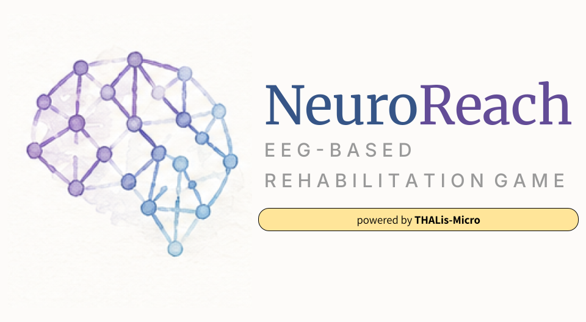

# NeuroReach: EEG-Assisted Rehab



Welcoming games for seated upper-limb practice. Play with buttons, touch, a camera, or a supported EEG headset.

**[Open NeuroReach](https://blizzard-labs.github.io/thalis-rehab-game/)** · [Companion setup](#companion-setup) · [Help](#troubleshooting) · [Developer guide](docs/development.md)

## Choose how to play

| I want to… | What I need |
| --- | --- |
| Play independently with buttons, touch, or a camera | [Open the website](https://blizzard-labs.github.io/thalis-rehab-game/). No installation or EEG headset needed. |
| Start and monitor a supervised patient session | Set up the [companion](#companion-setup) on the clinician's computer. |
| Play with a Unicorn EEG headset | Set up the [companion](#companion-setup), then follow [EEG setup](#play-with-an-eeg-headset). |
| Use camera controls with familiar outside games | Install the [Game Controller extension](#play-familiar-games) in desktop Chrome or Edge. |

**Current availability:** the public website supports independent play. Hosted staff sessions are not available yet; supervised sessions currently use the companion.

## Start playing

1. Open the website and choose **Garden Grow**, **Star Catcher**, **River Rowing**, **Fruit Picking**, or **Lighthouse Keeper**.
2. Choose **One button** or **Camera**, then **Start game**.
3. Read the first-use notice. For camera play, allow camera access and follow the on-screen steps to set comfortable resting and reaching positions.
4. Use **Pause** or **End session** whenever you need to.
5. At the end, choose **Session report** to view your results. Choose **Save on this device** if you want them included in future progress reports.

You can switch to one-button controls if camera setup is difficult. On a shared device, use **Next guest** before another person plays; it clears that browser's saved guest history and starts a fresh player.

<a id="local-eeg-companion"></a>

## Companion setup

The companion runs on your computer and provides the staff workspace, supervised session connections, and EEG access. **You do not need a headset for supervised button or camera games.**

The current public setup uses the steps below. A general-purpose, signed installer is not available yet. A clinic's IT support can complete the one-time setup for you.

### 1. Install the prerequisites — once

- [Node.js](https://nodejs.org/en/download): select **22 LTS**, version **22.12 or later**. Its installer includes npm.
- [Miniconda](https://www.anaconda.com/docs/getting-started/miniconda/install): provides the Python environment used by the companion.
- [Download NeuroReach](https://github.com/blizzard-labs/thalis-rehab-game/archive/refs/heads/main.zip) and extract the ZIP. Keep the extracted folder somewhere permanent.

### 2. Open the project folder in a command window

On **Windows**, open **Anaconda Prompt** from the Start menu. On **macOS/Linux**, open **Terminal** after completing Miniconda setup.

Type `cd `, followed by the full path to the extracted folder in quotation marks, then press Enter. For example, on Windows:

```text
cd "C:\Users\YOUR-NAME\Downloads\thalis-rehab-game-main"
```

Replace the example path with your actual folder. Use the folder containing `package.json`, `patient-web`, and `signal-engine`; extraction may create an extra outer folder.

### 3. Install NeuroReach — once

Run these commands **one at a time**, waiting for each to finish before starting the next:

```sh
npm --prefix patient-web ci
conda create -n eeg python=3.10 -y
conda run -n eeg python -m pip install -r signal-engine/requirements-companion.txt
npm run build
```

The first installation downloads several packages and may take a few minutes. If this computer already has the `eeg` environment, skip the `conda create` line.

### 4. Start the companion — each time you use it

From the same project folder, run:

```sh
npm run companion
```

Wait for **NeuroReach ready at http://127.0.0.1:8766**, then open **[NeuroReach on this computer](http://127.0.0.1:8766/)**.

- Keep the command window open during play and supervision.
- The website's **Open local staff workspace** and **Open local player** buttons now work on this computer too.
- After ending any sessions, press **Ctrl+C** in the command window to stop the companion.
- Next time, repeat **step 4**; you do not need to reinstall everything.

## Start a supervised session

**On the clinician's computer:**

1. Start the companion, then open **[Staff workspace](http://127.0.0.1:8766/#staff)**.
2. On first use, create a staff password of at least 10 characters. Keep it somewhere secure; it protects this computer's records.
3. Add a participant label and confirm their agreement to the session.
4. Choose the game, practice arm, input, pace, and session length.
5. Select **Start supervised session** to display a QR code and private patient link.

**On the patient's device:**

1. Connect to the **same Wi-Fi/network** as the clinician's computer.
2. Scan the QR code or open the patient link. Select **Pair this display**.
3. Wait for the clinician to select **Start patient game**. For camera play, allow camera access and complete the movement setup.

The clinician sees the game and, when enabled, the live camera preview. They can pause, resume, switch to button input, and end the session. One companion supports one active supervised session at a time.

**Trying it on one computer?** Select **Open on this computer** in the invitation panel to open a separate patient window.

**First connection on another device:** your clinic may need to trust the station's security certificate before the game or camera works. Use **First-time device connection** in the invitation panel and ask IT to complete certificate setup. See the [network setup guide](docs/development.md#patient-device-network-and-certificates) for technical details.

## Play with an EEG headset

Supported device: **g.tec Unicorn Hybrid Black**, using the [manufacturer's software and setup guidance](https://www.gtec.at/unicorn-faq/) and LSL bridge. Other EEG headsets are not currently supported.

1. Complete [companion setup](#companion-setup) on the headset computer. For the current Unicorn setup, use Windows with g.tec's software installed.
2. Connect the headset and start its stream in the **Unicorn Suite LSL bridge**.
3. Open the **local** NeuroReach player, choose a game, and select **EEG headset** or **Camera + EEG**.
4. Select the device and practice arm. Follow the resting calibration, which requires **60 seconds of clean signal**.
5. Complete any additional on-screen setup, then begin. You can fall back to button input if needed.

For platform-specific LSL installation and technical checks, see [EEG developer notes](docs/development.md#eeg-runtime-and-calibration).

## Play familiar games

Choose **Play familiar games** on the website to explore titles such as Fruit Ninja and 2048. Ordinary touch or keyboard play does not need an extension.

For camera controls in **desktop Chrome or Edge**:

1. Download the **NeuroReach Game Controller** from the library and unzip it.
2. Open your browser's Extensions page, turn on **Developer mode**, and select **Load unpacked**. Choose the extracted `neuroreach-game-controller` folder containing `manifest.json`.
3. Reload the NeuroReach library, open a game, then use the extension's toolbar button to choose the playable area.
4. Keep the default **Sidebar**, choose your input, complete setup, and select **Enable controls**.

**Alt+Shift+S** stops game input. Keep the controller open while using camera controls. After downloading an updated extension, replace its files and select **Reload** on the browser's Extensions page.

Outside games are for independent play, need internet, and use their providers' terms. They do not generate NeuroReach session reports. EEG controls require the local companion's library. See the [full extension instructions](game-controller-extension/README.md).

## Reports and saved information

| To… | Choose… |
| --- | --- |
| Review one round | **Session report** after play or in session history. |
| Review changes over time | **Saved sessions → Progress report**, or select a participant in Staff workspace. |
| Keep a copy | **Download PDF** or **Export CSV** in the report. |
| Include a guest round in future trends | **Save on this device** after that round. |

Guest history stays in the browser where it was saved. Supervised records stay on the companion computer. Export a station backup before moving or updating that computer; exported files are separate copies.

## Troubleshooting

| What you see | What to do |
| --- | --- |
| “The local companion is unavailable” or a local page will not open | Start `npm run companion` on **this computer**, leave its window open, and wait for the ready message. The public website cannot start it for you. |
| `npm` or `conda` is not recognized | Finish installing Node.js and Miniconda, then reopen the command window. On Windows, use Anaconda Prompt. |
| `package.json` or a requirements file cannot be found | Return to setup step 2. You must run the commands inside the extracted project folder. |
| “Run npm run build … first” | Run `npm run build` in the project folder, then restart the companion. |
| Camera is blocked | Allow camera access in browser settings and close other apps using it. On a paired device, complete the station certificate setup with IT. |
| The patient link will not connect | Check that both devices use the same network. Use the QR/session link, not the clinician's `127.0.0.1` address. Ask IT about firewall access or guest Wi-Fi device isolation. |
| The invitation expired or was already used | Create a fresh invitation using the session controls. For an interrupted active visit, use **Reconnect patient device**. |
| No EEG device appears | Confirm that the Unicorn LSL bridge is streaming on the companion computer. Use button or camera play while resolving headset setup. |

## About NeuroReach

NeuroReach is an experimental wellness and engagement tool. It does not replace therapy or diagnose a condition. Reports describe practice, not proven recovery. Read **Safety & privacy** in the app and use comfortable movements within your clinician's guidance.

[Introduction video](https://youtu.be/hHVyAqoD-6w) · [System walkthrough](https://youtu.be/Uo2iDNLLS2w) · [Project resources](https://neuroreach.notion.site/NeuroReach-EEG-Assisted-Motor-Rehabilitation-RESOURCES-3ac0b3bfcc1381189586e200abe4d8cd)

**Developers and IT:** build commands, configuration, tests, deployment, packaging, and architecture are in the **[developer guide](docs/development.md)**.
