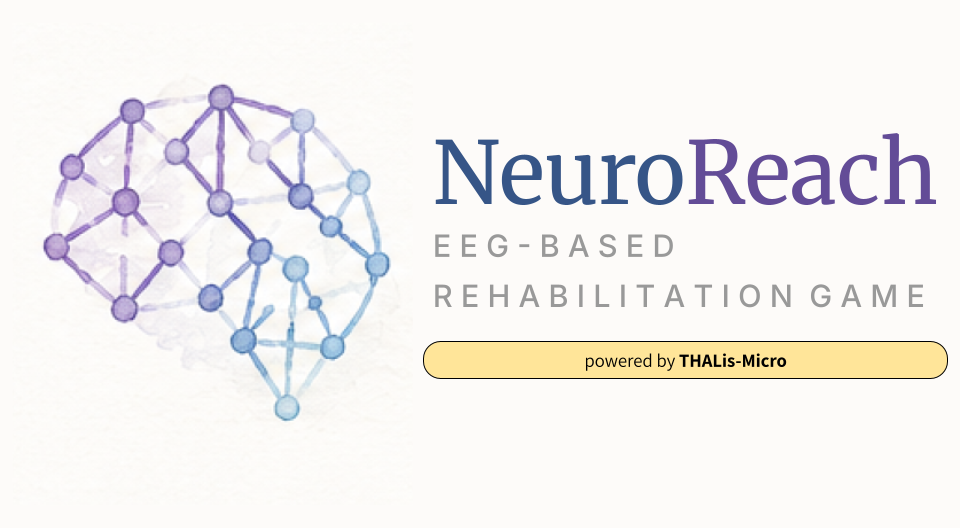

# 🧠 NeuroReach: EEG-Assisted Stroke Rehabilitation

<div align="center">
  
</div>

> Repository: `thalis-rehab-game`

A closed-loop **EEG neurofeedback rehabilitation game** for stroke survivors. Patients perform motor
imagery; the system decodes sensorimotor-rhythm (mu/beta) event-related desynchronization (ERD) from a
[g.tec Unicorn Hybrid Black](https://www.gtec.at/product/unicorn-hybrid-black/) headset, fuses it with
optional camera-based movement verification, and drives a real-time web game — turning the quality of a
patient's mental effort into a continuously growing, non-punitive reward.

NeuroReach is **offline-first and clinic-LAN-only**: a full session runs with zero internet connectivity
and no patient health information ever leaves the clinic PC.


* **Brief Introduction: [https://youtu.be/hHVyAqoD-6w](https://youtu.be/hHVyAqoD-6w)**
* **System Walkthrough: [https://youtu.be/Uo2iDNLLS2w](https://youtu.be/Uo2iDNLLS2w)**


---

## How it works

```
Unicorn EEG (8ch, 250 Hz)  ─BLE→  Clinic PC ─────────────────────────────┐
                                   Electron Clinician Console             │
                                     ├─ Python signal-engine sidecar      │  clinic LAN
                                     │    filter → CAR → ERD/CSP+LDA       │  (HTTPS/WSS/WebRTC)
                                     │    → IntentScore (0–100 @ 20 Hz)    │
                                     └─ LAN server: serves the web game,   │
                                        pairs a device, relays the score   ▼
                                                          Patient device (any browser)
                                                          React game · webcam → clinic
```

A single normalized **IntentScore (0–100)** drives all game mechanics. The full engineering
specification is in **[`docs/specs.md`](docs/specs.md)**; current status is in
**[`docs/todos.md`](docs/todos.md)**.

## Subsystems

| Directory | What | Stack |
|---|---|---|
| [`signal-engine/`](signal-engine/) | Real-time EEG acquisition, preprocessing, ERD + CSP/LDA scoring, IntentScore fusion, 20 Hz WebSocket transport | Python 3.10+, `numpy`/`scipy`/`mne`/`scikit-learn`, `pylsl`, `websockets` |
| [`clinician-console/`](clinician-console/) | Desktop console (patient roster, live monitor, history, protocol editor) + LAN server that serves the patient game and pairs devices | Electron, React, TypeScript, Vite |
| [`patient-web/`](patient-web/) | Patient-facing web game (Garden Grow, Star Catcher) driven by the live score | React, TypeScript, Vite |

## Features

- **Real-time MI decoding** — causal filtering, common-average reference, artifact gating, mu/beta ERD +
  laterality index, per-patient CSP+LDA classifier with a cross-validation quality gate.
- **Adaptive, non-punitive feedback** — EMA-smoothed score, per-session adaptive normalization; the game
  grows quickly and wilts gently, never resets punitively.
- **"BCI illiteracy" fallback** — Blended/Active modes let camera-confirmed movement carry scoring weight
  for the ~40% of patients who don't decode well from EEG alone _(vision pipeline is the next milestone)_.
- **Clinician console (C1–C5)** — searchable roster, live signal-quality + score monitor, history/trends,
  clinical-scale assessments with CSV export, protocol editor.
- **Zero-install patient client** — served over the clinic LAN; a QR + short session code pairs any
  browser device to the live session.
- **Accessibility-first** — WCAG-AA contrast, colorblind-safe palettes, `prefers-reduced-motion`, no
  strobe, large targets, plain-language non-comparative copy.

View a sample auto-generated report **[`here`](NeuroReach-StarCatcher-Session-Report-Sample.pdf)**

## Quick start

Prerequisites: **Conda** (Python env `eeg`), **Node.js ≥ 18** + npm. No EEG headset required — a mock
Unicorn outlet with a virtual motor-imagery driver ships in-repo.

### 1. Signal engine (mock EEG → live score)

```bash
# One-time: create the conda env with the signal stack (numpy, scipy, mne, scikit-learn, pylsl, websockets)
conda create -n eeg python=3.10 -y && conda activate eeg
pip install numpy scipy mne scikit-learn pyriemann pylsl websockets pyedflib joblib

# Run the server: MockUnicornOutlet → scoring pipeline → ws://localhost:8765 (20 Hz IntentScore)
conda run -n eeg python signal-engine/run_ws_server.py
```

The virtual-MI driver cycles ERD (6 s on / 3 s rest) so the score actually moves. Disable with
`NEUROREACH_NO_MI=1`.

### 2. Patient web game

```bash
cd patient-web && npm install
npm run dev        # http://localhost:5173 — connects to ws://localhost:8765
```

### 3. Clinician console (Electron)

```bash
cd clinician-console && npm install
npm run dev        # Electron main spawns the sidecar + LAN server; opens the console
```

> The console's LAN pairing features (QR, remote device) only run under Electron (`npm run dev`), not the
> plain Vite renderer — `window.neuroreach` (the preload bridge) is the guard.

## Testing

```bash
# Signal engine — 59 passed, 6 skipped (skips are opt-in on-head/live tests)
conda run -n eeg python -m pytest signal-engine/tests/

# Patient web — 58 unit tests (Vitest + jsdom)
cd patient-web && npm run test
npm run test:integration     # boots the real mock-EEG sidecar and drives the plant

# Clinician console — 88 unit tests (Vitest)
cd clinician-console && npm run test
npm run test:integration     # boots the real sidecar + LAN spine
```

**Live hardware tests** (real Unicorn worn): `THALIS_LIVE_UNICORN=1 conda run -n eeg python -m pytest
signal-engine/tests/test_live_unicorn.py`. The real Unicorn LSL stream advertises type `Data` with no
channel labels — connect with `EEGInlet(stream_type="Data")` or `EEGInlet(stream_name="<device-serial>")`.

## Repository layout

```
thalis-rehab-game/
├── docs/
│   ├── specs.md           # full engineering specification (v2 architecture)
│   ├── todos.md           # whole-project status board + test inventory
│   ├── gardengrow.md      # Garden Grow game design
│   ├── reachcollect.md    # Reach & Collect / Star Catcher design + ROM roadmap
│   └── wireframes/        # UI wireframes (C1–C5 console, P1–P6 patient)
├── signal-engine/         # Python real-time service (see subsystems table)
├── clinician-console/     # Electron + React console + LAN server
└── patient-web/           # React + Vite patient game
```
